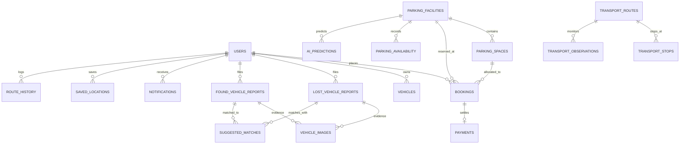

# SmartPark AI — Database Design Documentation

## 1. Overview
SmartPark AI employs a normalized relational database schema designed for PostgreSQL (with SQLite compatibility for local rapid prototyping and testing). The schema supports multi-tenant roles, real-time smart parking discovery, transactional advance spot reservation, AI occupancy tracking, GPS facility routing, public transit crowd telemetry, and the Lost & Found Vehicle Recovery system.

---

## 2. Entity-Relationship Summary

---

## 3. Detailed Table Specifications

### 3.1 `users`
Stores authenticated platform accounts across Citizen, Operator, and Administrator tiers.
- `id`: `SERIAL PRIMARY KEY`
- `email`: `VARCHAR(255) UNIQUE NOT NULL` — Lowercase index
- `hashed_password`: `VARCHAR(255) NOT NULL` — Bcrypt / Argon2 hash
- `full_name`: `VARCHAR(150) NOT NULL`
- `phone`: `VARCHAR(30)`
- `role`: `VARCHAR(50) DEFAULT 'citizen'` — Constraints: `citizen`, `operator`, `admin`
- `is_active`: `BOOLEAN DEFAULT TRUE`
- `created_at`, `updated_at`: `TIMESTAMP DEFAULT CURRENT_TIMESTAMP`

### 3.2 `parking_facilities`
Physical parking lots and multi-level automated garages.
- `id`: `SERIAL PRIMARY KEY`
- `name`: `VARCHAR(200) NOT NULL`
- `address`, `city`: `TEXT`, `VARCHAR(100)`
- `latitude`, `longitude`: `DOUBLE PRECISION NOT NULL` (Spatial index for geo-radius queries)
- `total_capacity`, `available_spaces`: `INTEGER NOT NULL`
- `hourly_rate`: `DOUBLE PRECISION NOT NULL` (Currency: INR)
- `operator_id`: `INTEGER REFERENCES users(id)`
- `operating_hours`: `VARCHAR(100)`
- `amenities`: `TEXT` (CSV: EV Charging, Covered, CCTV, etc.)

### 3.3 `parking_spaces`
Individual demarcated parking spots.
- `id`: `SERIAL PRIMARY KEY`
- `facility_id`: `INTEGER REFERENCES parking_facilities(id) ON DELETE CASCADE`
- `space_number`: `VARCHAR(50) NOT NULL` (e.g., P-01)
- `space_type`: `VARCHAR(50)` (standard, compact, suv, ev, disabled, two_wheeler)
- `floor`: `VARCHAR(20)`
- `is_occupied`: `BOOLEAN DEFAULT FALSE`

### 3.4 `bookings`
Advance and on-demand parking reservations.
- `id`: `SERIAL PRIMARY KEY`
- `booking_reference`: `VARCHAR(50) UNIQUE NOT NULL` (e.g., SP-BK-2026-9041)
- `user_id`: `INTEGER REFERENCES users(id)`
- `facility_id`: `INTEGER REFERENCES parking_facilities(id)`
- `space_id`: `INTEGER REFERENCES parking_spaces(id)`
- `vehicle_number`, `vehicle_type`: `VARCHAR(50)`
- `start_time`, `end_time`: `TIMESTAMP NOT NULL`
- `total_amount`: `DOUBLE PRECISION NOT NULL`
- `status`: `CONFIRMED`, `CHECKED_IN`, `COMPLETED`, `CANCELLED`

### 3.5 `payments`
Transactional audit ledger for payments.
- `id`: `SERIAL PRIMARY KEY`
- `booking_id`: `INTEGER REFERENCES bookings(id)`
- `user_id`: `INTEGER REFERENCES users(id)`
- `amount`: `DOUBLE PRECISION NOT NULL`
- `status`: `PENDING`, `SUCCESS`, `FAILED`, `REFUNDED`
- `payment_method`: `online`, `UPI (Sandbox)`, `card`
- `razorpay_order_id`, `razorpay_payment_id`: `VARCHAR(100)`
- `transaction_reference`: `VARCHAR(100) UNIQUE NOT NULL`
- `is_simulated`: `BOOLEAN DEFAULT TRUE`

### 3.6 `lost_vehicle_reports` & `found_vehicle_reports`
Two-sided recovery system for lost, stolen, or abandoned vehicles.
- `report_reference`: Unique tracking code (e.g. `LV-2026-XXXX`, `FV-2026-XXXX`)
- `license_plate`: Vehicle registration number
- `vehicle_type`, `make`, `model`, `color`: Normalized vehicle attributes
- `last_seen_location` / `found_location`: Descriptive address + coordinates
- `last_seen_datetime` / `found_datetime`: Timestamps
- `contact_name`, `contact_phone`: Reporter contact info
- `hide_contact_details`: Privacy toggle (redacts numbers in public views)
- `status`: `OPEN`, `POTENTIAL_MATCH`, `UNDER_REVIEW`, `RESOLVED`, `CLOSED`

### 3.7 `suggested_matches`
Rule-based & AI similarity scored vehicle correlation.
- `lost_report_id`, `found_report_id`: Foreign keys
- `match_score`: Float between 0.0% and 100.0%
- `match_reasons`: Detailed string breakdown (License plate distance, make/model, color, geo-radius)
- `is_verified`: Boolean confirmed by authorized administrator
- `status`: `PENDING`, `CONFIRMED`, `REJECTED`

### 3.8 `transport_routes`, `transport_stops`, `transport_observations`
Public transit telemetry and crowd density analytics.
- `crowd_level`: `LOW`, `MODERATE`, `HIGH`, `VERY_HIGH`
- `crowd_percentage`: Numeric crowd ratio (0 - 100%)
- `is_simulated`: Boolean distinction between live GTFS/sensors and synthetic estimates.
